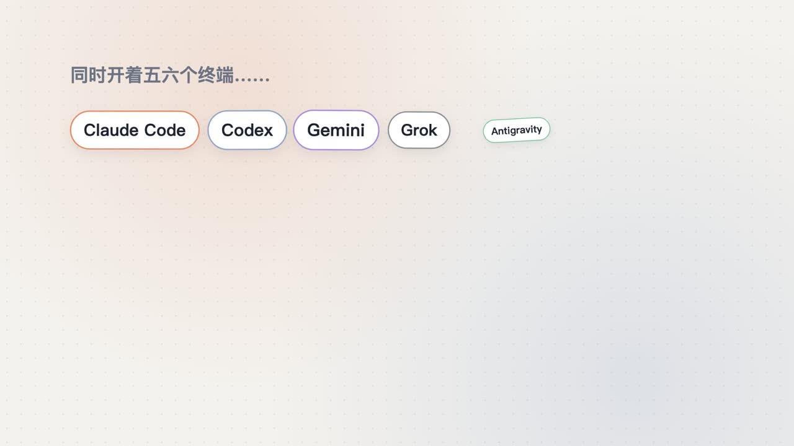

# Agent Office（magpie 页面插件）

[](docs/promo.mp4)

> 55 秒宣传片：[docs/promo.mp4](docs/promo.mp4)（`promo/` 是 Remotion 源码，素材用 `promo/capture.mjs` 从 demo 页面逐帧录制）。


在 magpie 侧边栏加一个“Agent 办公室”页：本机 Claude Code、Codex、Gemini CLI、Grok、Antigravity 会话谁在干活、谁可能在等你批准、谁刚做完，一眼看清。思路参考 [whatsmyagentdoing](https://github.com/Charonyuu/whatsmyagentdoing)。

## 为什么分两部分

magpie 的页面插件跑在 `sandbox="allow-scripts"` 的 iframe 里，`connect-src 'none'`，只能 `magpie.read("usage:summary" | "providers:list")`，读不到会话。所以：

- `page/`：magpie 页面插件。读取今日用量和本插件 options（端口、令牌），然后把自己的 frame 跳到本机服务。
- `server/office.mjs`：本机服务，只监听 `127.0.0.1:47615`，读日志并提供办公室页面。无依赖，Node 18+。

## 安装

```sh
magpie plugin add <本目录的绝对路径>
node server/office.mjs          # 前台试运行；启动时会自动写入插件 options
sh scripts/launchd.sh install   # 或：登录后常驻（uninstall 卸载，status 查看）
```

magpie 正在运行时，用 CLI 新加的插件要在 magpie 重启后才出现在侧边栏。

## 数据与状态

| 来源 | 读取 |
|---|---|
| `~/.claude/projects/*/*.jsonl` | 消息、工具调用与结果、`ai-title`、token |
| `~/.codex/sessions/YYYY/MM/DD/*.jsonl` | `task_started/complete`、`turn_aborted`、工具调用与输出、`token_count` |
| `~/.codex/session_index.jsonl` | Codex 线程名 |
| `~/.grok/sessions/<编码后的目录>/<id>/` | `events.jsonl`（`permission_requested` 直接算“等你批准”）、`summary.json`、`usage.json` |
| `~/.gemini/tmp/<slug>/chats/session-*.jsonl` | 消息、工具调用、`awaiting_approval`；slug 通过 `projects.json` 反查目录 |
| Antigravity `brain/<id>/.system_generated/logs/transcript.jsonl` | `USER_REQUEST`、模型、工具调用；标题和运行状态用 `sqlite3 -readonly` 读 `conversation_summaries.db` |

只看最近 12 小时（`AGENT_OFFICE_WINDOW_HOURS`）内改动过的文件，最多扫描 120 个、输出 40 个会话；文件只增量读取新增部分。标题只取你输入的部分，编辑器附加的 `<editor-context>…` 之类的块会被去掉。

| 状态 | 判断 |
|---|---|
| 干活中 | 回合未结束，5 分钟内有动静；或 Bash 命令仍在运行 |
| 等你批准 / 等你回答 | 一个“可能问你”的工具调用 20 秒以上没有结果（见下表） |
| 已完成，待查看 | 回合结束不到 30 分钟 |
| 被中断 / 没动静了 / 空闲 | 用户中断；回合未结束但 5 分钟到 2 小时无动静；其余 |

日志不记录审批弹窗，所以“等你”仍是推断，但只在这次调用确实可能停下来问你时才算：

| 来源 | 算“等你” | 不算 |
|---|---|---|
| Claude Code | `AskUserQuestion`、`ExitPlanMode`（等你回答）；非 `bypassPermissions` 下的 Bash、WebFetch、Skill、MCP 工具；非 `acceptEdits` 下的 Edit/Write | Read、Grep、子代理等不弹审批的工具；后台 Bash；**进程列表里能看到正在执行的 Bash 命令**（Claude Code 用 `eval '<命令>'` 运行它，所以跑很久也算“干活中”） |
| Codex | `request_user_input`（等你回答）；`approval_policy` 不是 `never` 且 `approvals_reviewer` 是 `user` 时，申请提权的命令（`sandbox_permissions: require_escalated`）、`apply_patch`；`untrusted`/`on-failure` 下的所有命令 | `never` 或 `auto_review` 下的命令；沙箱内的普通命令；MCP 工具、`write_stdin` 等 |

仍可能误判：Claude 不在 `bypassPermissions` 模式时，单次耗时超过 20 秒的 MCP 工具调用会被算成“等你批准”，因为 MCP 工具在进程列表里看不出是否在运行。`npm test` 覆盖以上场景。

默认隐藏：magpie 为“Codex 线程跑在 Claude 上”起的 `magpie-claude-work-*` 会话（与该 Codex 线程重复，`AGENT_OFFICE_SHOW_BRIDGE=1` 显示）；不在干活或等待的子线程。

## 安全

- 只绑定 `127.0.0.1`，校验 `Host` 头（防 DNS rebinding）。
- `/api/state` 需要令牌（`~/.config/agent-office/token`，0600），令牌只通过 magpie 插件 options 交给页面。
- 接口只返回标题、项目目录名、模型、token 数和状态，不返回对话内容。

## 美术管线

### 3D 办公室（默认）

`server/public/office3d.js` 用 three.js 实时渲染整间办公室，布局沿用 `art/render.py`：左列是茶水间、跑步机、卫生间，右列是 2×3 工位，另有沙发和行军床。

- 拖拽旋转，滚轮缩放，双击或“重设视角”复位。俯仰角和缩放有范围限制。
- 每个会话对应一个 magpie 官方吉祥物小鹊（`models/xiaoque.glb`，全身、Mixamo 骨骼，内含 `run`、`greet`、`cheer`、`frustrated` 四段动画）。角色本身不染色，用脚下色环和标签圆点区分模型家族：Claude 橙、Codex 蓝灰、Gemini 紫、Grok 灰、Antigravity 绿。3D 模式的头像用 `models/xiaoque_avatar.webp`。
- 活跃会话坐工位，面向自己的屏幕，“等你”优先。显示器是自发光屏幕：干活中是蓝色滚动条纹，角色打字；等你是琥珀色，角色招手，头顶显示“!”；已完成是绿色 ✓，角色欢呼；被中断是红色 ×，角色沮丧；没动静是暗屏加 zzz，角色趴桌。超出 6 个时，最后一个工位显示“+N”。
- 空闲会话去功能区，最多 5 个。悬停或点击角色弹出资料卡：项目、模型、token、最近活动和常用工具，不显示对话内容。
- three.js 放在本地 `server/public/vendor/`（MIT，版本见该目录 README），不走 CDN。服务只放行 `/sprites/`、`/vendor/`、`/models/` 三个子目录，文件名经过 `path.basename`。
- 每 3 秒轮询，按会话 id 增量更新；页面隐藏时停止渲染；遵守 `prefers-reduced-motion`。
- 调试参数：`demo=1` 是五种状态加空闲角色的假数据；`demo=2` 是长标题加多个空闲角色。

界面只提供 3D，没有 2D/3D 切换按钮。WebGL 不可用或模型加载失败时，页面自动退回 2D，避免白屏。

#### 小鹊模型怎么来的

1. 官方形象只有半身：magpie 内嵌的 `assets/plugins/redact/xq_light.webm`（脱敏原理示范里趴在桌后的动画）。从中截取一帧正面图作为参考。
2. 用 GPT 生图，根据参考图补全全身 A-pose 立绘：黑色百褶裙、黑色及膝袜、玛丽珍鞋，比例约 5 头身。
3. 交给 Tripo：High Detail v3.1 图生模型（约 2 万面，2K 贴图），然后 V3 自动绑骨（Mixamo 骨架），再重定向 `run`、`greet_01`、`cheer`、`frustrated_01` 四个预设动作。
4. 用 Blender 5 合并：把四个动画 GLB 的 action 挂到绑骨模型上，改成简短的名字，贴图缩小到 1024 JPEG，导出 `server/public/models/xiaoque.glb`。头像从官方帧裁成圆形，导出 `xiaoque_avatar.webp`。

Tripo 的导出接口在带 `animations` 参数时返回 Invalid parameter(s)，所以第 4 步改成逐个下载动画任务的 GLB，再在本地合并。

### 2D 回退

2D 模式里的办公室、休息区和吉祥物都是预渲染的透明 WebP（`server/public/sprites/`），页面只负责叠放和做 CSS 动画。

1. **参考图**：用 GPT 生图画出白色黏土风吉祥物，保存为 `art/ref/mascot.png`。
2. **3D 模型**：把参考图交给 Tripo 生成带贴图的 GLB，保存为 `art/models/mascot.glb`。
3. **渲染**：`art/render.py` 用 Blender（Cycles）搭建工位和休息区，用正交 3/4 俯视相机输出透明 PNG。
   - 每个工位分三层：`back_*`（地垫和椅子）、`mascot_*`（吉祥物）、`front_*`（桌子和笔记本，屏幕光颜色随状态变化）。
   - 被隐藏的层仍然投射阴影，所以三层叠起来和一次渲染出来的效果一致。
   - 吉祥物按模型家族上色：Claude 系模型是橙色，其他模型是蓝灰色。
4. **打包**：`art/pack.py` 把渲染结果转成 WebP，并写入 `meta.json`。`meta.json` 包含图片尺寸、笔记本屏幕光的位置，以及内容哈希 `v`。

重新渲染（需要 Blender 4.2 以上，约 1 分钟，请在前台运行）：

```sh
sh art/render.sh art/models/mascot.glb
```

页面会在精灵图 URL 后面加上 `?v=<哈希>`，所以重新渲染后不会被缓存挡住。不过 magpie 的插件 iframe 不会自动刷新，需要点菜单 View → Reload。

## 许可

MIT，见 `LICENSE`。小鹊形象和第三方组件的署名见 `NOTICE.md`。
